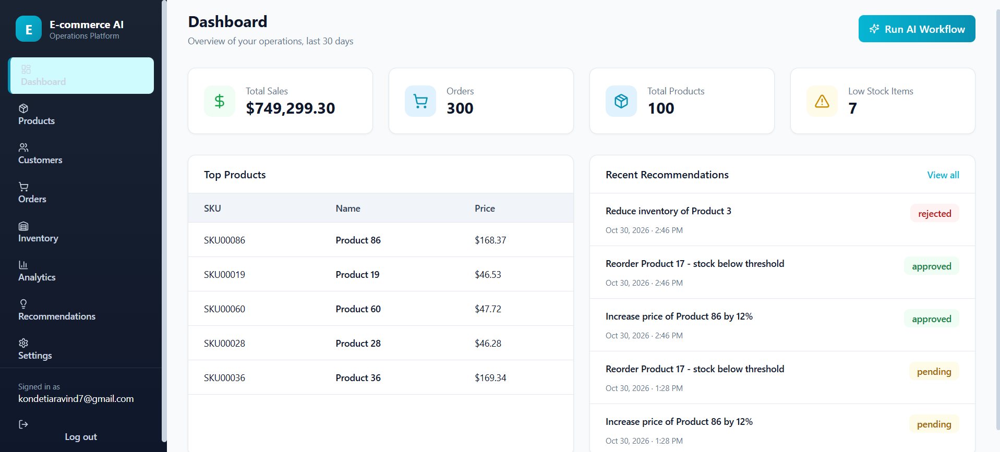
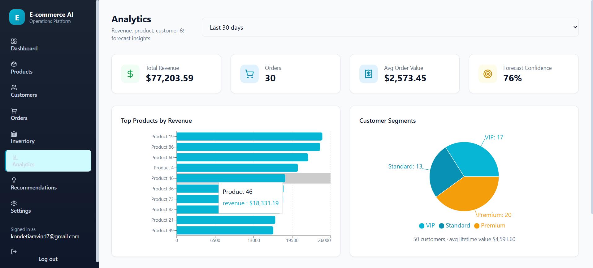
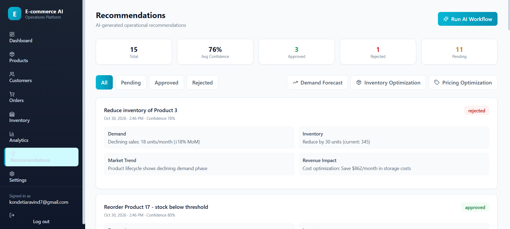
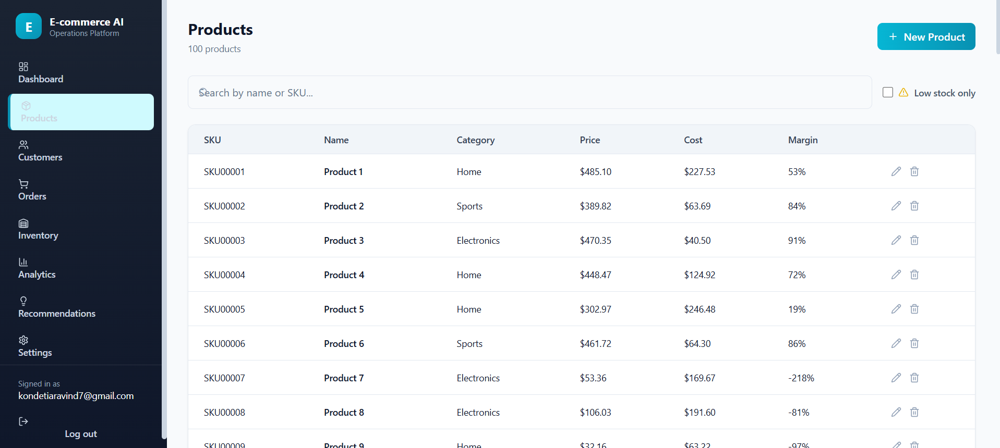

# E-commerce AI Operations Agent

An AI-powered operations platform for e-commerce businesses. This
platform uses an **Agentic AI / multi-agent approach** to analyze sales,
inventory, and product data and generate actionable operational
recommendations.

A coordinated workflow of specialized agents --- **Demand Forecasting,
Inventory Optimization, and Pricing Optimization** --- is synthesized by
an Executive Agent. The agents use Groq-powered LLM inference (Llama
3.3) and provide recommendation reasoning, confidence scores, and a
human-in-the-loop approval workflow. The platform also provides a
centralized operations dashboard for managing products, customers,
orders, inventory, and business analytics.

## Live Application

-   **Live AI Platform:**
    https://multi-agent-ecommerce-ai-platform.vercel.app
-   **Backend API:** https://ecommerce-ai-backend-nwuu.onrender.com
-   **Interactive API Documentation:**
    https://ecommerce-ai-backend-nwuu.onrender.com/docs
-   **GitHub Repository:**
    https://github.com/KondetiAravind/multi-agent-ecommerce-ai-platform

The frontend is deployed on Vercel, the FastAPI backend is deployed on
Render, and PostgreSQL data is hosted on Neon.

> **Demo access and security:** The live platform uses administrator
> authentication. Do not publish a production administrator password in
> this repository. For public testing, configure a separate demo account
> with a unique, temporary password and appropriately limited
> permissions, then share those demo credentials separately. Never
> commit production credentials, API keys, database URLs, JWT secrets,
> or `.env` files.

## Screenshots

The screenshots below are stored in `docs/screenshots/`. Replace the
images while keeping their existing filenames and paths to update the
README without changing these references.

### Operations Dashboard



### Analytics, Recommendations, and Products

  ------------------------------------------------------------------------------------------------------------------------------------------------------
  Analytics                                      AI Recommendations                                         Products
  ---------------------------------------------- ---------------------------------------------------------- --------------------------------------------
        

  ------------------------------------------------------------------------------------------------------------------------------------------------------

## Features

-   **Agentic AI Recommendations** --- a coordinated multi-agent
    workflow in which demand forecasting, inventory optimization, and
    pricing optimization agents analyze business data; an executive
    agent synthesizes their outputs into actionable recommendations.
-   **LLM-powered reasoning** --- Groq-backed Llama 3.3 inference
    generates structured agent outputs. The workflow includes rule-based
    fallback behavior when an LLM call fails, so it can still produce
    usable recommendations.
-   **Human-in-the-loop decisions** --- review recommendation reasoning
    and confidence scores, then approve or reject recommendations.
-   **Operations Dashboard** --- sales, order, product, and low-stock
    inventory metrics.
-   **Products** --- product listing, search, low-stock filtering, and
    create/read/update/delete operations.
-   **Customers** --- customer segmentation, lifetime-value ranking, and
    order history.
-   **Orders** --- order listing and details, with ship, refund, and
    cancel actions.
-   **Inventory** --- inventory visibility, low-stock alerts, one-click
    reorder, and manual adjustment.
-   **Analytics** --- revenue, product performance, customer segment,
    and forecast analytics.
-   **Authentication** --- JWT-based single-admin authentication with
    protected API endpoints.

## Agentic AI Architecture

The platform follows a **specialized-agent collaboration pattern**. Each
agent focuses on a specific operational domain, and the Executive Agent
combines the outputs into recommendations for the business user.

``` text
                 E-commerce Business Data
             (Sales, Products, Inventory, Orders)
                            |
                            v
                 +----------------------+
                 |  Demand Forecasting  |
                 |        Agent         |
                 +----------------------+
                            |
                            v
                 +----------------------+
                 | Inventory            |
                 | Optimization Agent   |
                 +----------------------+
                            |
                            v
                 +----------------------+
                 | Pricing Optimization |
                 |        Agent         |
                 +----------------------+
                            |
                            v
                 +----------------------+
                 |   Executive Agent    |
                 | Synthesis & Decision |
                 +----------------------+
                            |
                            v
                 Actionable Recommendations
                 + Reasoning + Confidence
                            |
                            v
                  Human Review / Approval
                      /           \
                  Approve         Reject
```

The current implementation uses a custom Python orchestration workflow
in `backend/workflows/`. It is LangGraph-style in its agent
coordination, but should not be interpreted as a dependency on the
LangGraph package. The LLM client communicates with Groq; agent-level
fallback logic provides rule-based outputs if an LLM request fails.

## Technology Stack

### Backend

  -----------------------------------------------------------------------
  Technology                          Purpose
  ----------------------------------- -----------------------------------
  **Python**                          Backend programming language

  **FastAPI**                         REST API framework and automatic
                                      OpenAPI documentation

  **Uvicorn**                         ASGI application server

  **SQLAlchemy**                      ORM and database interaction

  **PostgreSQL (Neon)**               Hosted relational database

  **psycopg2-binary**                 PostgreSQL database driver

  **Pydantic**                        Data validation and settings

  **PyJWT**                           JWT authentication

  **Groq API**                        LLM inference provider

  **Llama 3.3 70B Versatile**         LLM model configured for agent
                                      reasoning

  **ChromaDB**                        Vector-store component included in
                                      the backend

  **Pandas & NumPy**                  Data processing and sample-data
                                      loading
  -----------------------------------------------------------------------

### Frontend

  -----------------------------------------------------------------------
  Technology                          Purpose
  ----------------------------------- -----------------------------------
  **Next.js 15 (App Router)**         React framework and frontend
                                      application

  **React 19**                        UI component library

  **TypeScript**                      Static typing

  **Tailwind CSS**                    Styling and responsive UI

  **Recharts**                        Charts and analytics visualizations

  **Axios**                           HTTP client for backend API
                                      requests

  **Lucide React**                    Icon library
  -----------------------------------------------------------------------

### Deployment & Infrastructure

  -----------------------------------------------------------------------
  Platform / Tool                     Purpose
  ----------------------------------- -----------------------------------
  **Vercel**                          Frontend hosting and deployment

  **Render**                          FastAPI backend hosting

  **Neon**                            Managed PostgreSQL hosting

  **Git & GitHub**                    Version control and source-code
                                      hosting

  **Environment Variables**           Production configuration and secret
                                      management
  -----------------------------------------------------------------------

## Project Structure

``` text
.
├── backend/
│   ├── app.py                       # FastAPI app, metrics & workflow endpoints
│   ├── config.py                    # Environment-driven application settings
│   ├── agents/                      # Agent tool definitions
│   ├── database/                    # SQLAlchemy models & database session
│   ├── llm/                         # Groq client & agent prompts
│   ├── memory/                      # ChromaDB vector-store component
│   ├── routers/                     # auth, products, customers, orders,
│   │                                # inventory, analytics, ai_ops
│   ├── scheduler/                   # Scheduled workflow task definitions
│   ├── services/                    # Business logic per domain
│   ├── workflows/                   # Multi-agent orchestration
│   ├── scripts/
│   │   └── load_kaggle_data.py      # Sample data loader
│   └── requirements.txt             # Backend Python dependencies
│
├── frontend/
│   ├── src/
│   │   ├── app/
│   │   │   ├── login/               # Login page
│   │   │   └── dashboard/           # Protected application shell & pages
│   │   │       ├── products/
│   │   │       ├── customers/
│   │   │       ├── orders/
│   │   │       ├── inventory/
│   │   │       ├── analytics/
│   │   │       ├── recommendations/
│   │   │       └── settings/
│   │   ├── components/
│   │   │   ├── ui/                  # Reusable UI components
│   │   │   └── layout/              # Layout components, including Sidebar
│   │   ├── context/                 # Authentication context
│   │   ├── lib/                     # API client and formatting utilities
│   │   └── types/                   # Shared TypeScript types
│   └── package.json
│
├── docs/
│   └── screenshots/
│       ├── dashboard.png
│       ├── analytics.png
│       ├── recommendations.png
│       └── products.png
│
├── .env.example                     # Environment-variable template
├── .gitignore
└── README.md
```

## Prerequisites

-   Python 3.12+ for the documented local development setup (the
    deployed Render service is pinned to Python 3.11.11 for dependency
    compatibility).
-   Node.js 18+ and npm.
-   A PostgreSQL database, for example a free
    [Neon](https://console.neon.tech) instance.
-   A [Groq API key](https://console.groq.com) for LLM-powered agent
    inference.
-   Git.

## Setup

### 1. Clone the repository

``` bash
git clone https://github.com/KondetiAravind/multi-agent-ecommerce-ai-platform.git
cd multi-agent-ecommerce-ai-platform
```

### 2. Backend setup

Create and activate a virtual environment:

``` powershell
# Windows PowerShell
python -m venv .venv
.\.venv\Scripts\Activate.ps1
```

``` bash
# macOS / Linux
python3 -m venv .venv
source .venv/bin/activate
```

Install the backend dependencies:

``` bash
pip install -r backend/requirements.txt
```

Configure environment variables. The backend reads its settings from
`backend/.env` in the local setup:

``` powershell
# Windows PowerShell
Copy-Item .env.example backend/.env
```

``` bash
# macOS / Linux
cp .env.example backend/.env
```

Edit `backend/.env` and provide the required values. Use your own
credentials and never commit this file.

``` env
DATABASE_URL=your_neon_postgresql_connection_string
GROQ_API_KEY=your_groq_api_key
SECRET_KEY=generate_a_long_random_secret
ADMIN_EMAIL=your_admin_email
ADMIN_PASSWORD=use_a_strong_unique_password
GROQ_MODEL=llama-3.3-70b-versatile
GROQ_TEMPERATURE=0.3
GROQ_MAX_TOKENS=2000
```

Use the actual variable names and any additional settings defined in
`.env.example` and `backend/config.py`. Keep secrets out of source
control.

Run the backend:

``` bash
python -m uvicorn backend.app:app --reload --host 0.0.0.0 --port 8000
```

The API is available at `http://localhost:8000`. Interactive Swagger
documentation is available at `http://localhost:8000/docs`. On startup,
the application initializes the database tables.

### 3. Frontend setup

Open a second terminal:

``` bash
cd frontend
npm install
```

Create `frontend/.env.local`:

``` env
NEXT_PUBLIC_API_URL=http://localhost:8000
```

Run the frontend:

``` bash
npm run dev
```

Open <http://localhost:3000> and sign in using the `ADMIN_EMAIL` and
`ADMIN_PASSWORD` configured for the backend.

## Sample Data

To populate a development database with sample products, customers,
orders, and inventory from the Kaggle e-commerce dataset, use:

``` bash
python backend/scripts/load_kaggle_data.py
```

Run this only against a database you intend to populate. Do not rerun it
against a production database unless you have checked the script's
behavior and are comfortable with its effects.

## API Overview

All endpoints, other than `/health`, `/info`, and `/api/auth/login`,
require a `Bearer` token obtained from `POST /api/auth/login`.

  -----------------------------------------------------------------------
  Area                                Base path / endpoints
  ----------------------------------- -----------------------------------
  Auth                                `POST /api/auth/login`

  Health & Info                       `GET /health`, `GET /info`

  Metrics & Workflow                  `GET /api/metrics`,
                                      `POST /api/workflow/trigger`

  Recommendations                     `GET /api/recommendations`,
                                      `POST /api/approve/{id}`,
                                      `POST /api/reject/{id}`

  Products                            `/api/products` (CRUD, `/search`,
                                      `/category`, `/low-stock`,
                                      `/import`)

  Customers                           `/api/customers` (CRUD,
                                      `/segments`, `/lifetime`,
                                      `/{id}/orders`)

  Orders                              `/api/orders` (CRUD, `/{id}/items`,
                                      `/{id}/ship`, `/{id}/refund`)

  Inventory                           `/api/inventory` (CRUD,
                                      `/low-stock`, `/reorder`,
                                      `/transfer`)

  Analytics                           `/api/analytics/revenue`,
                                      `/products`, `/customers`,
                                      `/forecast`

  AI Operations                       `/api/ai/forecast`,
                                      `/optimize-inventory`,
                                      `/optimize-pricing`, `/performance`
  -----------------------------------------------------------------------

Full request and response models are available through the
auto-generated Swagger UI:

-   Local: `http://localhost:8000/docs`
-   Production: https://ecommerce-ai-backend-nwuu.onrender.com/docs

## Production Deployment

The application is deployed as three connected services:

### Frontend --- Vercel

-   **Platform:** Vercel
-   **Framework:** Next.js
-   **Root directory:** `frontend`
-   **Live URL:** https://multi-agent-ecommerce-ai-platform.vercel.app
-   **Production environment variable:**

``` env
NEXT_PUBLIC_API_URL=https://ecommerce-ai-backend-nwuu.onrender.com
```

### Backend --- Render

-   **Platform:** Render Web Service
-   **Runtime:** Python 3.11.11
-   **Build command:**

``` bash
pip install -r backend/requirements.txt
```

-   **Start command:**

``` bash
uvicorn backend.app:app --host 0.0.0.0 --port $PORT
```

-   **Backend URL:** https://ecommerce-ai-backend-nwuu.onrender.com
-   **API documentation:**
    https://ecommerce-ai-backend-nwuu.onrender.com/docs

Configure production environment variables in the Render dashboard. At
minimum, provide the database connection string, Groq API key, JWT
secret, administrator credentials, and CORS origin configuration. Do not
store production secrets in GitHub.

The `CORS_ORIGINS` setting is a list and should be supplied as a JSON
array, for example:

``` json
["https://multi-agent-ecommerce-ai-platform.vercel.app"]
```

### Database --- Neon

-   **Database:** PostgreSQL
-   **Provider:** Neon
-   **Purpose:** Persistent application data for products, customers,
    orders, inventory, and recommendations.

The deployed backend connects to the configured Neon database using the
`DATABASE_URL` environment variable.

### Deployment notes

-   The frontend and backend are deployed independently.
-   The frontend communicates with the backend through
    `NEXT_PUBLIC_API_URL`.
-   The backend must allow the deployed Vercel domain through
    `CORS_ORIGINS`.
-   Render's free instance may spin down after inactivity, which can
    cause a delay on the first request after a period of inactivity.
-   Production secrets are configured in the hosting providers'
    environment settings, not in the repository.

## Development

Type-check, lint, and build the frontend:

``` bash
cd frontend
npm run type-check
npm run lint
npm run build
```

Run the backend and frontend in separate terminals during local
development.

## Security Notes

-   Never commit `.env`, `backend/.env`, `frontend/.env.local`, API
    keys, database connection strings, JWT secrets, or administrator
    passwords.
-   Use a long, unique `SECRET_KEY` and a strong administrator password
    in production.
-   Do not use a production administrator account as a public demo
    account.
-   For public demonstrations, create a separate demo identity and
    restrict its permissions where possible.
-   Rotate any credential that has been exposed publicly or shared
    insecurely.

## Author

**Kondeti Aravind**\
Dual Degree, Computer Science and Engineering\
Indian Institute of Technology Bhubaneswar

-   **GitHub:** https://github.com/KondetiAravind
-   **Project Repository:**
    https://github.com/KondetiAravind/multi-agent-ecommerce-ai-platform

## License

Refer to the repository's `LICENSE` file for the applicable license
terms. If no `LICENSE` file is present, all rights remain with the
respective copyright holders; do not assume the project is open-source
or assign a license without adding one.
